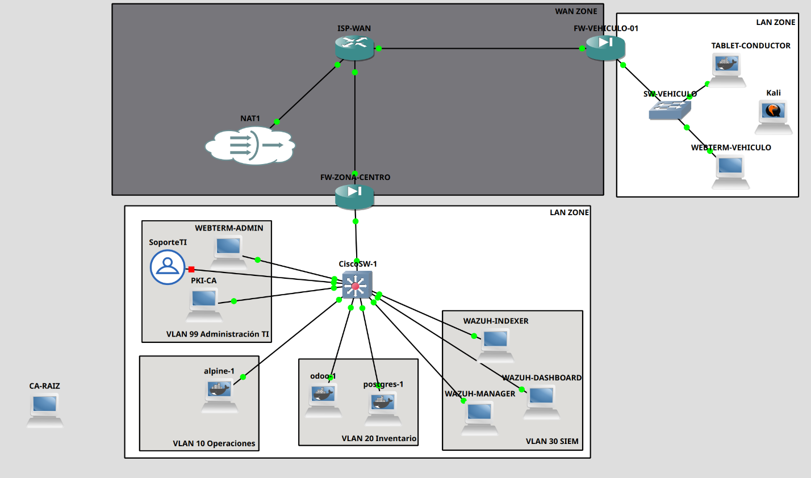
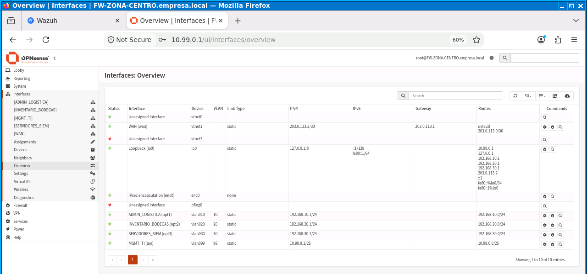
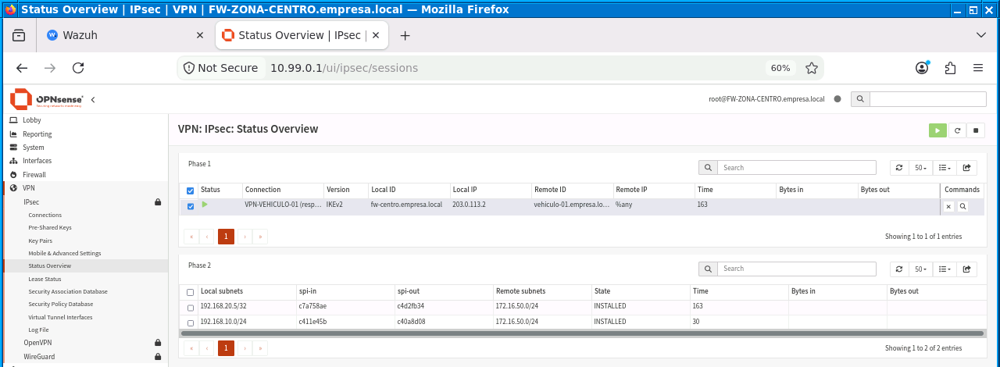
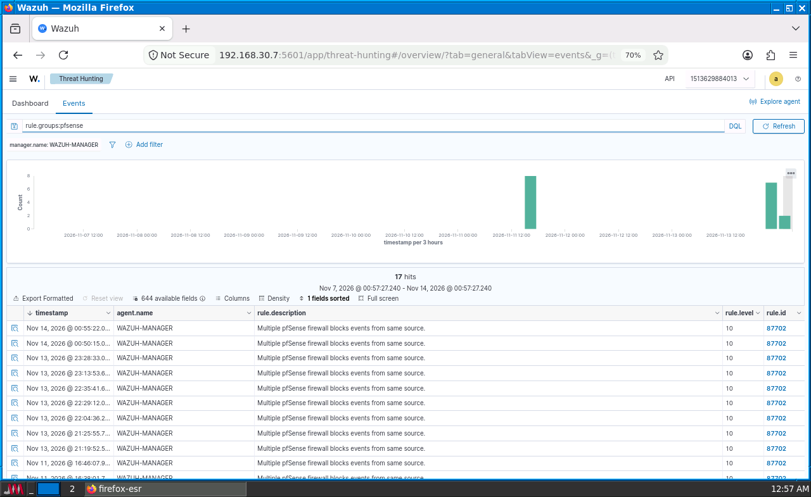

# Evaluación formativa U3 – Seguridad perimetral – Caso 2 Logística (Zona Centro)

## Portada

| Campo | Detalle |
|---|---|
| Asignatura | Seguridad en Redes (CI3062) · Sección CI3062_N6_C2 |
| Evaluación | Formativa Unidad 3: Seguridad perimetral (criterios 3.1.1 y 3.1.2) |
| Caso | Caso 2 – Logística, Zona Centro |
| Grupo | Zona Centro |
| Fecha | 13-11-2026 |
| Docente | Marcos Pozas |
| Integrantes y roles | Martín Arroyo – Monitoreo · Andrés Chandía – Documentación · Jasser Flores – Arquitectura · Carlos Mac-Iver – Laboratorio |
| Plataforma de laboratorio | GNS3 con QEMU-KVM y Docker: firewall y concentrador VPN OPNsense 26.7 (FreeBSD 15.1), switch Cisco IOSv-L2, router ISP Cisco IOSv, SIEM Wazuh 4.14 (manager, indexer y dashboard) |
| IDS/IPS | Suricata 8.0.6, incluido en OPNsense (disponibilidad verificada; se activa en la Fase 2) |
| Documentación del fabricante | OPNsense Handbook, <https://docs.opnsense.org/> (firewall, IPsec, IDS/IPS, registro y respaldo) |

Este informe continúa el informe de la Unidad 2 (criptografía): sus canales C1–C5, activos ACT-01 a ACT-07 y riesgos R1–R8 se reutilizan aquí. Cada flujo recibe un código F-xx que se mantendrá en la Fase 2 (reglas R-xx, eventos E-xx y perfiles P-xx).

---

## Paso 1. Reconocimiento de la arquitectura (3.1.1)

### 1.1 Esquema de arquitectura

Todo el tráfico entre VLAN y hacia el exterior pasa por un solo punto de control: el firewall `FW-ZONA-CENTRO`, que también es el concentrador VPN y el lugar donde operará el IPS. El switch es solo de capa 2 y no enruta entre VLAN. La DMZ es una zona propuesta (sugerencia del docente): alojaría la pasarela B2B que media entre los socios y el inventario, sin exponer el inventario.



*Captura 1. Topología del laboratorio en GNS3 (13-11-2026, 21:53).* `CA-RAIZ` aparece sin enlaces porque es la CA raíz fuera de línea. `Kali` (en la LAN del vehículo, sin enlaces) y `SoporteTI` (VLAN 99) están apagados; solo se encienden si una prueba los necesita.

El firewall concentra los tres controles (filtrado, VPN e IPS); los vehículos y los usuarios remotos entran por el túnel, y los socios B2B llegarían solo a la DMZ.

### 1.2 Tabla de direccionamiento

| Segmento / VLAN | Zona | Red / máscara | Gateway | Dispositivos activos en el laboratorio |
|---|---|---|---|---|
| VLAN 10 `ADMIN_LOGISTICA` | Interna: usuarios y operación de bodega | 192.168.10.0/24 | 192.168.10.1 | `alpine-1` (terminal de bodega, DHCP .230) |
| VLAN 20 `INVENTARIO_BODEGAS` | Interna crítica: inventario y trazabilidad | 192.168.20.0/24 | 192.168.20.1 | `odoo-1` WMS (.5), `postgres-1` base de datos (.4) |
| VLAN 30 `SERVIDORES_SIEM` | Monitoreo | 192.168.30.0/24 | 192.168.30.1 | Wazuh: manager (.5), indexer (.6), dashboard (.7) |
| VLAN 99 `MGMT_TI` | Administración TI | 10.99.0.0/25 | 10.99.0.1 | Switch (.2), `PKI-CA` CA emisora (.10), `WEBTERM-ADMIN` (.20), `SoporteTI` |
| DMZ (propuesta) | Servicios expuestos a terceros | 192.168.40.0/24 (propuesta) | 192.168.40.1 | Pasarela B2B / proxy inverso (a implementar) |
| WAN sede | Externa | 203.0.113.0/30 | 203.0.113.1 | `FW-ZONA-CENTRO` (.2, IP pública fija), `ISP-WAN` (.1) |
| Red móvil del operador | Externa (CGNAT) | 100.64.20.0/24 | 100.64.20.1 | `FW-VEHICULO-01` (DHCP .10); la sede lo ve como 198.51.100.10 |
| LAN del vehículo | Remota, por VPN | 172.16.50.0/24 | 172.16.50.1 | `TABLET-CONDUCTOR` (.10), `WEBTERM-VEHICULO` (.20) |
| Sin red | CA raíz fuera de línea | — | — | `CA-RAIZ` |

Las redes 203.0.113.0/24 y 198.51.100.0/24 son de documentación (RFC 5737) y 100.64.0.0/10 es el rango de CGNAT (RFC 6598): simulan Internet y la red móvil sin usar direcciones reales.

### 1.3 Matriz 1. Arquitectura, flujos y puntos de control perimetral

Se identificaron 8 flujos (la guía pide al menos 5), con al menos un acceso remoto (F-02, F-03), un flujo interno hacia la zona crítica (F-01) y flujos entre la zona interna y la externa (F-05, F-07). Exposición: A (alta), M (media), B (baja). Entre paréntesis, la dimensión afectada: C (confidencialidad), I (integridad), D (disponibilidad).

| Segmento o VLAN | Activo crítico asociado | Flujo de comunicación | Servicio / protocolo | Riesgo o exposición identificada | Punto de control perimetral | Importancia de la seguridad perimetral |
|---|---|---|---|---|---|---|
| VLAN 10 → VLAN 20 | ACT-01 WMS/ERP, ACT-02 terminales de bodega | **F-01** Terminales de bodega → WMS (consulta de stock y órdenes) | HTTP del WMS, TCP 8069 (a futuro HTTPS 443) | **M** · Alteración de órdenes o acceso directo a la base de datos desde un equipo de usuario comprometido (I, C) | Firewall entre VLAN: solo el puerto del WMS hacia un host | Limita el daño de un equipo de bodega comprometido: no llega a la base de datos ni al resto de la VLAN 20 |
| Zona externa (red móvil) → VLAN 20 | ACT-03 dispositivos del conductor, ACT-01 WMS | **F-02** Vehículo y tablet del conductor → WMS (entregas, GPS) | IPsec IKEv2 (UDP 500/4500, ESP) + TCP 8069 dentro del túnel | **A** · Red pública: intercepción, suplantación del conductor (C, I) | Concentrador VPN + reglas en la interfaz IPsec | El túnel cifra y autentica; el firewall deja pasar solo el WMS, y solo en el turno de despacho |
| Zona externa → VLAN 20 / 99 | ACT-01, ACT-05 credenciales, ACT-07 infraestructura | **F-03** Supervisores, gerencia y teletrabajadores → WMS (y administradores → VLAN 99) | IPsec IKEv2 con perfil por usuario | **A** · Acceso desde redes no confiables con privilegios altos (C, I) | Concentrador VPN: pool propio de IP, tratado como una zona aparte, con reglas por perfil | Cada perfil llega solo a lo que necesita; el pool VPN nunca cae directo en una VLAN interna |
| VLAN 99 → todos los segmentos | ACT-07 switch, firewall y configuraciones | **F-04** Administración TI de equipos y servidores | SSH 22, HTTPS 443, SNMP 161 | **M** · Quien administra controla la red; gestión desde otra VLAN = toma de control (C, I, D) | Firewall: gestión solo desde la VLAN 99 (condición 2 del caso) | Reduce la superficie de administración a un segmento de confianza y auditable |
| Zona externa → DMZ → VLAN 20 | ACT-04 documentos B2B (manifiestos, órdenes EDI) | **F-05** Clientes, proveedores y aduana → pasarela B2B en la DMZ → WMS | HTTPS 443 con autenticación mutua (AS2 sobre HTTPS) | **A** · Servicio publicado a Internet; si se compromete, punto de entrada a la red (I, C) | Firewall: publicación solo del 443 hacia la DMZ y de la DMZ al WMS solo un puerto; IPS en la WAN | El inventario nunca queda expuesto (condición 1 del caso); un compromiso de la pasarela queda contenido en la DMZ |
| Todos los segmentos → VLAN 30 | ACT-06 SIEM y logs | **F-06** Firewall, servidores y switch envían eventos al SIEM | Syslog UDP 514; agente Wazuh TCP 1514/1515 | **B** · Sin eventos no hay detección; logs alterados ocultan una intrusión (I, D) | Firewall entre VLAN: hacia el SIEM solo los puertos de registro | El SIEM recibe los eventos del perímetro (condición 3 del caso) |
| VLAN 10 → zona externa | ACT-02 terminales de bodega | **F-07** Navegación y servicios en la nube | DNS 53, NTP 123, HTTPS 443 (NAT de salida) | **A** · Descarga de malware, fuga de datos, tráfico sin cifrar (C, I) | Firewall + NAT + IPS en la WAN | Solo sale lo necesario y cifrado; la red interna queda oculta tras la IP pública |
| VLAN 10/20/30 → VLAN 99 | ACT-05 claves de la PKI | **F-08** Equipos consultan revocación de certificados (CRL y OCSP) | HTTP 80 (CRL), TCP 2560 (OCSP) | **B** · Abrir la VLAN 99 exponería la CA emisora (C, I) | Firewall: solo esos dos puertos hacia un host | Permite validar certificados sin abrir el segmento de administración |

### 1.4 Importancia de la seguridad perimetral en el caso

El activo que sostiene la operación es el WMS de la VLAN 20: stock, órdenes de despacho, guías y trazabilidad. Lo rodean cuatro tipos de acceso con niveles de confianza distintos: los terminales de bodega (VLAN 10), los conductores en ruta sobre redes móviles públicas, los supervisores y teletrabajadores que se conectan desde fuera, y los socios B2B que intercambian manifiestos. La segmentación en VLAN separa a estos grupos, pero no decide qué puede pasar entre ellos. Esa decisión la toma el perímetro.

Sin los puntos de control de la Matriz 1, un solo equipo de bodega comprometido llegaría a la base de datos de inventario; un conductor con la tablet robada entraría a toda la red interna; un servicio B2B publicado dejaría el inventario a un salto de Internet, y la administración de los equipos podría hacerse desde cualquier segmento. En los tres casos se pierde integridad (órdenes y stock alterados para desviar carga), confidencialidad (datos de clientes y ubicación de conductores) y disponibilidad: si el WMS se cae o se cifra, se detienen la bodega y el despacho.

El perímetro reduce esa exposición en tres capas. El firewall aplica mínimo privilegio entre zonas y registra lo que permite y lo que bloquea. El IPS inspecciona el tráfico que entra desde la WAN y desde la VPN. La VPN cifra y autentica a quien se conecta desde fuera y lo deja en una zona propia, con permisos según su perfil. Todo envía eventos al SIEM, que permite detectar y reaccionar.

El riesgo residual se concentra en lo que sí debe pasar: un usuario legítimo con credenciales robadas dentro de su perfil, o un ataque a la aplicación del WMS por su puerto permitido. Para eso se proponen la autenticación por certificado con segundo factor y el monitoreo de eventos.

---

## Paso 2. Funcionalidades de firewall, IPS/IDS y VPN (3.1.2)

### 2.1 Tabla 2. Funcionalidades perimetrales aplicadas a la arquitectura del caso

| Componente | Funcionalidad básica o avanzada | Flujo, segmento o activo protegido | Acción esperada en la red | Evidencia de laboratorio o referencia revisada | Explicación técnica del grupo |
|---|---|---|---|---|---|
| Firewall | **Básica:** filtrado por origen, destino y servicio, con inspección de estado y segmentación entre zonas | F-01 (VLAN 10 → WMS), F-04, F-08 · ACT-01 | Desde la VLAN 10 solo pasa TCP 8069 hacia el WMS; la base de datos y el resto de la VLAN 20 quedan bloqueados. Las respuestas vuelven por el estado de la conexión, sin regla de retorno | `alpine-1` → WMS: HTTP 303 (llega); `alpine-1` → `postgres-1:5432`: bloqueado (evidencias E1 y E2, sección 3) | Un firewall con estado (pf en OPNsense) evalúa la primera conexión y recuerda las autorizadas. Así se aplica la denegación por defecto entre VLAN y solo se abren excepciones justificadas (riesgos U2 R2, R7) |
| Firewall | **Avanzada:** NAT de salida, objetos (alias), reglas por horario y registro por regla enviado al SIEM | F-07 (VLAN 10 → Internet), F-02 (vehículo) · ACT-02, ACT-03 | La red interna sale con la IP pública (NAT) y solo por DNS, NTP y HTTPS; el conductor llega al WMS solo en el turno de despacho; cada paquete permitido o bloqueado queda registrado con su regla | Log del firewall con líneas `pass` y `block` y la etiqueta de cada regla; tablet fuera de turno: sin acceso (evidencia E3) | El NAT oculta el direccionamiento interno. Los alias agrupan hosts y puertos para que las reglas sean legibles y auditables. El horario aplica el principio de "acceso solo cuando se necesita", y el registro permite auditar y correlacionar en el SIEM |
| IPS/IDS | **Básica:** detección por firmas (modo IDS) con alertas | F-07 y F-05 (tráfico desde y hacia la WAN) · ACT-01, ACT-02 | Ante tráfico que coincide con una firma conocida (malware, escaneo, explotación), se genera una alerta sin cortar el tráfico | Suricata 8.0.6 incluido en OPNsense 26.7; descarga de las firmas ET Open verificada desde el firewall (referencia: INCIBE, SIEM, IDS e IPS) | Un IDS compara el tráfico con patrones de ataque conocidos y avisa. No bloquea, así que no arriesga la disponibilidad del despacho ante un falso positivo. Se usará en la interfaz IPsec, donde el tráfico llega ya descifrado |
| IPS/IDS | **Avanzada:** modo prevención (IPS en línea) y envío de alertas al SIEM para correlación | F-05 y F-07 en la WAN, F-02 en la VPN · ACT-06 | En la WAN, el IPS descarta la conexión maliciosa antes de que llegue a la DMZ o a la red interna; la alerta llega a Wazuh y se correlaciona con los bloqueos del firewall | Wazuh ya correlaciona los bloqueos repetidos del firewall desde un mismo origen (regla 87702, nivel 10) y genera la alerta (evidencia E6) | El IPS actúa en línea: puede bloquear, no solo avisar. Por eso se pone donde el riesgo es mayor (la WAN). El SIEM centraliza las alertas del IPS y del firewall para detectar patrones que un solo componente no ve |
| VPN | **Básica:** túnel cifrado con autenticación mutua entre la sede y el vehículo (IPsec IKEv2, sitio a sitio) | F-02 · ACT-03, ACT-01 | El tráfico del conductor viaja cifrado por la red móvil; si la IP del vehículo cambia o queda tras CGNAT, el túnel se mantiene gracias a NAT-T | Túnel `ESTABLISHED`, 2 Child SA `INSTALLED`, ESP AES-GCM-128 con ECP-256, encapsulado en UDP 4500 por NAT-T (evidencia E4) | IPsec protege confidencialidad e integridad en una red no confiable (riesgo U2 R1). Hoy la autenticación es con clave compartida; la Fase 2 la cambia a certificados ECDSA emitidos por la PKI propia, como define el informe de la U2 (R3) |
| VPN | **Avanzada:** perfiles de usuario y restricción de privilegios: cada túnel o pool de acceso remoto llega solo a lo que su perfil necesita, y las sesiones se monitorean | F-02 (conductor), F-03 (supervisor, teletrabajador, administrador) · ACT-05, ACT-07 | El conductor solo llega al WMS; un supervisor remoto llegaría solo al WMS y solo el administrador a la VLAN 99. Las sesiones VPN quedan registradas | Tablet del conductor → VLAN 10 y → base de datos: bloqueadas; → WMS en turno: HTTP 303 (evidencia E3) | Una VPN no debe dar acceso a toda la red: el pool VPN se trata como una zona aparte y el firewall aplica reglas por perfil (mínimo privilegio). Con segundo factor y cierre por inactividad se limita el uso de credenciales robadas |

### 2.2 Interpretación de la referencia

Pendiente de revisión: confirmar si el docente entregó una regla o alerta de referencia. Mientras tanto, se interpreta la regla del túnel del vehículo hacia el WMS que existe en el laboratorio.

| Elemento | Interpretación |
|---|---|
| Elemento de referencia (firewall) | Interfaz IPsec · permitir · TCP · origen `RED_VEHICULO` (172.16.50.0/24) · destino `WMS_ODOO` (192.168.20.5) · puerto 8069 · registro activado · horario de despacho. Después, una regla final: bloquear todo con registro |
| Flujo que protege | F-02: conductor → WMS. Activos ACT-03 (dispositivo del conductor) y ACT-01 (WMS) |
| Acción que ejecuta | Deja pasar solo las conexiones nuevas del vehículo al puerto del WMS, en el turno; las respuestas vuelven por estado. Todo lo demás que llega por el túnel (base de datos, VLAN 10, administración) cae en la regla final y queda registrado |
| Cómo se verificaría en laboratorio | Desde `TABLET-CONDUCTOR`: (1) acceso al WMS en horario → responde; (2) acceso fuera de horario → sin respuesta; (3) ping a un equipo de la VLAN 10 y conexión a `postgres-1:5432` → sin respuesta. En el log del firewall: líneas `pass` con la etiqueta de la regla y líneas `block` con la de la regla final, con hora, origen, destino y puerto. Resultado observado: evidencia E3 |

---

## 3. Evidencias de laboratorio

Los registros de texto (E0 a E6) se tomaron el 13-11-2026 entre 21:04 y 21:15 (hora de Chile) desde las consolas de GNS3. Los equipos registran en UTC (00:04–00:15 del 14-11). Las capturas de pantalla se tomaron después, entre las 21:53 y las 22:13 del mismo día; cada pie indica la hora.

### E0 · Interfaces y zonas del firewall

Consola de `FW-ZONA-CENTRO`; flujos F-01 a F-08. Cada VLAN termina en una interfaz propia del firewall, que es el único enrutador entre zonas:

```text
ADMIN_LOGISTICA (vlan010) -> v4: 192.168.10.1/24
INVENTARIO_BODEGAS (vlan020) -> v4: 192.168.20.1/24
MGMT_TI (vlan099) -> v4: 10.99.0.1/25
SERVIDORES_SIEM (vlan030) -> v4: 192.168.30.1/24
WAN (vtnet1) -> v4: 203.0.113.2/30
```



*Captura 2. Interfaces → Overview de `FW-ZONA-CENTRO`, abierto desde `WEBTERM-ADMIN` (VLAN 99) el 13-11-2026 a las 22:13. Muestra las cuatro VLAN (10, 20, 30 y 99) sobre `vtnet0`, la WAN en `vtnet1` y la interfaz IPsec `enc0`.*

### E1 · Conectividad permitida desde la VLAN 10

`alpine-1` (192.168.10.230); flujos F-01 y F-07. Llega al WMS y sale a Internet por HTTPS:

```text
== http://192.168.20.5:8069/web/login
  HTTP/1.1 303 SEE OTHER
== https://example.com
  HTTP/1.1 200 OK
```

### E2 · Tráfico bloqueado desde la VLAN 10

Flujos F-01 y F-07. La base de datos del inventario no es alcanzable y HTTP sin cifrar no sale:

```text
== http://example.com
wget: download timed out
== pg 5432
BLOQUEADO
```

### E3 · Conductor por la VPN

`TABLET-CONDUCTOR` (172.16.50.10); flujo F-02. Fuera del turno de despacho no llega al WMS; nunca llega a la VLAN 10 ni a la base de datos. Registro del firewall del bloqueo (interfaz IPsec `enc0`, acción `block`, origen, destino y puerto):

```text
== odoo (fuera de turno)
wget: download timed out
== VLAN10 ping
2 packets transmitted, 0 packets received, 100% packet loss

filterlog: ...,enc0,match,block,in,4,...,tcp,60,172.16.50.10,192.168.20.5,56294,8069,...
```

Con el horario abierto (prueba): `HTTP/1.1 303 SEE OTHER` hacia el WMS y `BLOQUEADO` hacia `postgres-1:5432`.

### E4 · Túnel VPN activo

`FW-ZONA-CENTRO`, `swanctl --list-sas`; flujo F-02:

```text
#1, ESTABLISHED, IKEv2
  #3, reqid 1, INSTALLED, TUNNEL-in-UDP, ESP:AES_GCM_16-128/ECP_256
  #4, reqid 2, INSTALLED, TUNNEL-in-UDP, ESP:AES_GCM_16-128/ECP_256
```



*Captura 3. VPN → IPsec → Status Overview de `FW-ZONA-CENTRO` (13-11-2026, 22:13). Fase 1: IKEv2 con `vehiculo-01.empresa.local`. Fase 2: dos Child SA `INSTALLED`, 192.168.20.5/32 ↔ 172.16.50.0/24 (WMS) y 192.168.10.0/24 ↔ 172.16.50.0/24. El segundo sigue negociado, pero las reglas que lo usaban están deshabilitadas y la regla final R-99 bloquea ese tráfico (evidencia E3). Se elimina al rehacer la VPN con certificados en la Fase 2.*

### E5 · Administración solo desde la VLAN 99

`PKI-CA` (10.99.0.10); flujo F-04:

```text
== https://10.99.0.1            (GUI del firewall)
  HTTP/1.1 200 OK
== https://192.168.30.7:5601    (dashboard de Wazuh)
  HTTP/1.1 302 Found
== ssh switch
ABIERTO
```

### E6 · El SIEM recibe eventos del perímetro

Flujo F-06. Wazuh tiene 15 alertas `filterlog` del firewall con la regla 87702, *"Multiple pfSense firewall blocks events from same source"*, nivel 10.



*Captura 4. Eventos del firewall en el dashboard de Wazuh (Threat Hunting → Events, filtro `rule.groups:pfsense`, últimos 7 días), abierto desde `WEBTERM-ADMIN` (VLAN 99) el 14-11-2026 a las 00:57 UTC (13-11, 21:57 en Chile). Muestra 17 alertas de la regla 87702: las 15 del momento de las pruebas y 2 nuevas generadas después.*

---

## 4. Síntesis

La seguridad perimetral protege el inventario de la empresa logística obligando a que todo acceso a la VLAN 20 pase por un punto de control que decide, registra y avisa. El firewall deja pasar solo los flujos de la Matriz 1, con mínimo privilegio y registro. El IPS revisa lo que entra desde Internet y desde la VPN. La VPN cifra y autentica a conductores, supervisores y teletrabajadores y los deja en una zona con permisos según su perfil. La DMZ propuesta permite atender a los socios B2B sin exponer el inventario. El SIEM reúne los eventos de todos ellos.

Para la Fase 2 (sumativa) quedan: autenticación de la VPN por certificados, activación de Suricata con alertas en Wazuh, implementación de la DMZ, VPN de acceso remoto por perfil, eventos E-xx vinculados a reglas R-xx, respaldo exportado y la política de control de acceso.

---

## 5. Bitácora del grupo (Anexo B)

| Fecha | Paso | Trabajo realizado | Integrantes presentes | Pendientes |
|---|---|---|---|---|
| Septiembre de 2026 (aprox.) | Montaje | Topología base en GNS3: VLAN 10/20/30/99, firewall OPNsense, Wazuh | Los cuatro integrantes | — |
| 09-11-2026 | Montaje | Actualización de la topología base | Los cuatro integrantes | — |
| 11-11-2026 | 1-A | VPN sede ↔ vehículo y Wazuh en Docker | Los cuatro integrantes | — |
| 13-11-2026 | 1-A, 1-B | PKI del laboratorio; revisión de interfaces y pruebas de conectividad; Matriz 1 | Los cuatro integrantes | — |
| 13-11-2026 | 2 | Tabla 2 e interpretación de la referencia; integración del informe formativo | Los cuatro integrantes | Retroalimentación del docente (llega después de la entrega) |

---

## 6. Referencias

- INCIBE (2020). *Recomendaciones de seguridad en el empleo de redes VPN.* <https://www.incibe.es/empresas/blog/recomendaciones-seguridad-el-empleo-redes-vpn>
- INCIBE (2020). *¿Qué son y para qué sirven los SIEM, IDS e IPS?* <https://www.incibe.es/empresas/blog/son-y-sirven-los-siem-ids-e-ips>
- INCIBE-CERT (2023). *Buenas prácticas en segmentación de redes industriales.* <https://www.incibe.es/incibe-cert/blog/buenas-practicas-en-segmentacion-de-redes-industriales>
- NIST SP 800-41 Rev. 1, *Guidelines on Firewalls and Firewall Policy*; NIST SP 800-77 Rev. 1, *Guide to IPsec VPNs*; NIST SP 800-94, *Guide to Intrusion Detection and Prevention Systems*.
- ISO/IEC 27002:2022, controles 5.15 (control de acceso), 8.20 (seguridad de redes) y 8.22 (segregación de redes).
- OPNsense Handbook. <https://docs.opnsense.org/>
- Grupo Zona Centro (2026). *Informe Técnico Ajustado – Caso 2 Logística, Unidad 2 (CI3062).*
