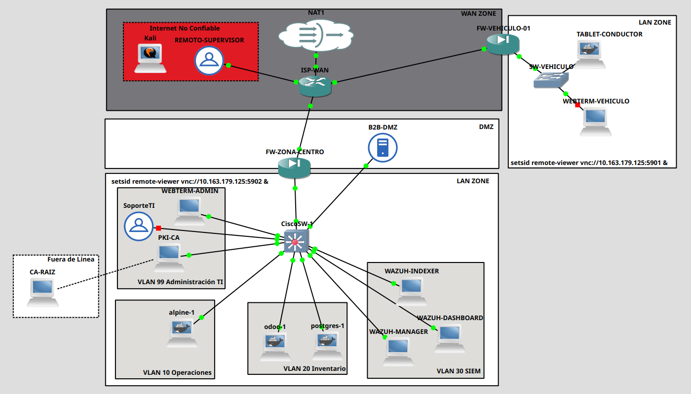

# Infraestructura actual del laboratorio `eval1`

Estado **posterior** al endurecimiento, al 2026-11-20 (evaluación sumativa U3, con el lienzo reordenado y los nombres simplificados ese mismo día). El estado anterior está congelado en [linea-base/INFRAESTRUCTURA.md](linea-base/INFRAESTRUCTURA.md). La fuente de verdad de nodos y enlaces es el `eval1.gns3` que tiene abierto el servidor GNS3 (ver la nota del final).

## 1. Segmentos

| Segmento | Red | Puerta de enlace | Equipos |
|---|---|---|---|
| VLAN 10 `ADMIN_LOGISTICA` | 192.168.10.0/24 | 192.168.10.1 (`FW-ZONA-CENTRO`) | `alpine` (DHCP, .230) |
| VLAN 20 `INVENTARIO_BODEGAS` | 192.168.20.0/24 | 192.168.20.1 | `odoo` (.5), `postgres` (.4) |
| VLAN 30 `SERVIDORES_SIEM` | 192.168.30.0/24 | 192.168.30.1 | `WAZUH-MANAGER` (.5), `WAZUH-INDEXER` (.6), `WAZUH-DASHBOARD` (.7) |
| VLAN 40 `DMZ_B2B` | 192.168.40.0/24 | 192.168.40.1 | `B2B-DMZ` (.10) |
| VLAN 99 `MGMT_TI` | 10.99.0.0/25 | 10.99.0.1 | `SW-ZONA-CENTRO` (.2), `PKI-CA` (.10), `WEBTERM-ADMIN` (.20), `SoporteTI` |
| Pool OpenVPN | 10.8.0.0/24 | 10.8.0.1 (`ovpns1`) | Clientes remotos (`REMOTO-SUPERVISOR` recibe .2) |
| WAN de la sede | 203.0.113.0/30 | 203.0.113.1 (`ISP-WAN`) | `FW-ZONA-CENTRO` (.2) |
| Red móvil del operador | 100.64.20.0/24 | 100.64.20.1 | `FW-VEHICULO-01` (.10, sale como 198.51.100.10) |
| "Internet" externa | 192.0.2.0/24 | 192.0.2.1 (`ISP-WAN` Gi0/3, DHCP desde .20) | `REMOTO-SUPERVISOR` (.10, fija), `Kali` (.20, DHCP), ambos tras `SW-INTERNET` |
| LAN del vehículo | 172.16.50.0/24 | 172.16.50.1 (`FW-VEHICULO-01`) | `TABLET-CONDUCTOR` (.10), `WEBTERM-VEHICULO` (.20) |
| Sin red | — | — | `CA-RAIZ` (CA raíz fuera de línea) |

## 2. Nodos

| Nodo | Tipo | Función | Consola |
|---|---|---|---|
| `FW-ZONA-CENTRO` | OPNsense 26.7, 4 GB RAM | Firewall de la sede: enrutamiento entre VLAN, NAT, IPsec, OpenVPN, Suricata IPS, syslog a Wazuh | telnet 5017 (serie) |
| `FW-VEHICULO-01` | OPNsense 26.7, 2 GB RAM | Router del vehículo, extremo IPsec | telnet 5023 (serie) |
| `SW-ZONA-CENTRO` | IOSv-L2 | Solo capa 2: VLAN 10/20/30/40/99, troncal Gi0/0 hacia el firewall; gestión solo por Vlan99 | telnet 5011 |
| `ISP-WAN` | IOSv | Operador: Internet (nodo NAT `INTERNET`), WAN de la sede, red móvil con CGNAT y red externa 192.0.2.0/24 con DHCP (pool `INTERNET_EXTERNA`) | telnet 5015 |
| `SW-INTERNET` | Ethernet switch de GNS3 | Une `ISP-WAN` Gi0/3 con `REMOTO-SUPERVISOR` y `Kali` | — |
| `B2B-DMZ` | Docker `b2b-dmz-gns3` | Pasarela B2B: nginx HTTPS 443 con certificado `as2.empresa.local` de PKI-CA; `/wms/` hacia el WMS | telnet 5014 |
| `REMOTO-SUPERVISOR` | Docker `remoto-gns3` | Cliente externo: OpenVPN (perfil P-03), pruebas de NAT y escaneos | telnet 5019 |
| `odoo`, `postgres` | Docker | WMS y su base de datos | telnet 5027, 5018 |
| `alpine` | Docker | Terminal de bodega (perfil P-01) | telnet 5021 |
| `TABLET-CONDUCTOR`, `WEBTERM-VEHICULO` | Docker | Dispositivos del conductor (perfil P-02) | telnet 5025, VNC 5901 |
| `WAZUH-MANAGER`, `WAZUH-INDEXER`, `WAZUH-DASHBOARD` | Docker, Wazuh 4.14.10 | SIEM | telnet 5031, 5034, 5036 |
| `WEBTERM-ADMIN` | Docker | Estación de administración (perfil P-04) | VNC 5902 |
| `PKI-CA`, `CA-RAIZ` | Docker `pki-ca-gns3` | CA emisora (CRL y OCSP) y CA raíz sin red | telnet 5008, 5010 |
| `Kali` | QEMU, 2 GB RAM | Atacante externo en la zona "Internet no confiable": 192.0.2.20 por DHCP. Las pruebas E-03 y P-05/P-06 de la sumativa se hicieron desde `REMOTO-SUPERVISOR` | SPICE |
| `SoporteTI` | QEMU | Estación de soporte en la VLAN 99, apagada | SPICE |

## 3. Enlaces nuevos respecto de la línea base

| Enlace | Puerto |
|---|---|
| `B2B-DMZ` eth0 ↔ `SW-ZONA-CENTRO` | Gi1/3 (acceso VLAN 40) |
| `ISP-WAN` Gi0/3 ↔ `SW-INTERNET` | e0 |
| `REMOTO-SUPERVISOR` eth0 ↔ `SW-INTERNET` | e1 |
| `Kali` Ethernet0 ↔ `SW-INTERNET` | e2 |

## 4. Servicios de seguridad

| Servicio | Dónde | Detalle |
|---|---|---|
| Filtrado | `FW-ZONA-CENTRO` | Tabla R-01 a R-99 con registro en todas las reglas ([U3_SUMATIVA.md](U3_SUMATIVA.md)) |
| NAT | `FW-ZONA-CENTRO` | 203.0.113.2:443 → 192.168.40.10:443; salida de la VLAN 10 como 203.0.113.2 |
| IPsec | `FW-ZONA-CENTRO` ↔ `FW-VEHICULO-01` | IKEv2, certificados X.509 de PKI-CA, AES-256-GCM, ECP-521, NAT-T; un Child SA 192.168.20.5/32 ↔ 172.16.50.0/24; regla R-02 con `HORARIO_DESPACHO` |
| OpenVPN | `FW-ZONA-CENTRO` | UDP 1194 en la WAN, pool 10.8.0.0/24, AES-256-GCM, certificados de PKI-CA, ruta solo al WMS |
| IPS | `FW-ZONA-CENTRO` | Suricata 8.0.6, Netmap en `vtnet1` y `vtnet0`, ET Open scan/exploit/web_server en modo *drop* |
| SIEM | `WAZUH-MANAGER` | Syslog UDP 514 desde el firewall y el switch; reglas locales 100200–100212 |
| PKI | `PKI-CA` | CRL en `http://10.99.0.10/crl/`, OCSP en 10.99.0.10:2560 ([PKI.md](PKI.md)) |

## 5. Nombres de nodos

El 2026-11-20 se simplificaron los nombres que GNS3 había numerado de forma automática. Los documentos históricos (línea base, informe formativo, bitácoras de `odd/`) conservan los nombres antiguos.

| Nombre anterior | Nombre actual | Contenedor Docker |
|---|---|---|
| `CiscoSW-1` | `SW-ZONA-CENTRO` (igual que su hostname) | — |
| `NAT1` | `INTERNET` | — |
| `odoo-1` | `odoo` | `GNS3.odoo.<id del proyecto>` |
| `postgres-1` | `postgres` | `GNS3.postgres.<id del proyecto>` |
| `alpine-1` | `alpine` | `GNS3.alpine.<id del proyecto>` |

Renombrar un nodo Docker hace que GNS3 recree el contenedor. Los datos de PostgreSQL y Odoo sobreviven porque están en volúmenes persistentes de GNS3 (`/var/lib/postgresql`, `/var/lib/odoo`); se comprobó la base (40 MB) y P-01, P-05 y P-06 después del cambio.

## 6. Lienzo GNS3

- **Zonas por color:** rojo punteado = Internet no confiable; gris = operador (`ISP-WAN`, `INTERNET`); verde agua = vehículo; ámbar = DMZ; azul = LAN Zona Centro, con un recuadro por VLAN; gris punteado = CA raíz fuera de línea.
- **Íconos por función** (set *affinity circle* de GNS3): cortafuegos, switches, nube, calavera para `Kali`, huella para la PKI, servidor y base de datos para el WMS, lupa, almacenamiento y gráfico para Wazuh. El color del ícono sigue la zona.
- **Notas:** cada nodo muestra su IP y servicio; los recuadros muestran red y puerta de enlace; las insignias PC-01 a PC-04 y su leyenda marcan los puntos de control de `FW-ZONA-CENTRO` (Figura 1 del informe).
- **Cuadrícula:** nodos y dibujos en una cuadrícula de 25 px con *snap to grid* activo; los rótulos de la LAN van bajo el ícono para que los enlaces no los crucen.
- Las credenciales no se escriben en el lienzo: están en [HOJA_TRAMPA.md](HOJA_TRAMPA.md).

## 7. Nota sobre `eval1.gns3`

El servidor GNS3 tiene abierto el proyecto desde `~/GNS3/projects/e96f2260-fe77-4449-8ab7-4650c7a9cd3d/eval1.gns3`. El `eval1.gns3` de este repositorio es una copia de ese archivo tomada el 2026-11-20 después de ordenar el lienzo. Si se cambia el laboratorio, hay que volver a copiarlo.
