# Plantilla de OPNsense 26.7 para GNS3

Imagen base de OPNsense ya instalada para usar como plantilla QEMU en GNS3. Se instaló una sola vez con QEMU y cada nodo de GNS3 arranca desde una copia enlazada (*linked clone*) de esa imagen, sin pasar de nuevo por el instalador.

Será el firewall de frontera de la sede central (`FW-ZONA-CENTRO`), que reemplaza a `RTR-ZONA-CENTRO`.

---

## 1. Resultado

| Elemento | Valor |
|---|---|
| Imagen base | `~/GNS3/images/QEMU/OPNsense-26.7-base.qcow2` |
| MD5 | `c48720546ce1e4929965094449a330b6` |
| Tamaño | 20 GiB virtuales, 2,4 GiB ocupados |
| Origen | `OPNsense-26.7-dvd-amd64.iso` (MD5 `ff6923ec931b33f3d25018d8e9b428d1`) |
| Sistema de archivos | UFS, particionado GPT/UEFI híbrido |
| Disco de instalación | `vtbd0` (interfaz virtio) |
| Usuario | `root` / `opnsense` (contraseña por defecto, sin cambiar) |
| Verificado (2026-11-11) | Arranca desde el disco sin el ISO (`Root file system: /dev/gpt/rootfs`) |

> La contraseña de `root` quedó en el valor de fábrica, `opnsense`. Para seguir la convención del laboratorio, cámbiala a `test123` en el primer arranque de cada nodo (opción 3 del menú de consola).

---

## 2. Plantilla en GNS3

**Creada el 2026-11-11** por la API del servidor GNS3 (`POST /v2/templates`), con los valores de esta tabla. La única diferencia con el plan original es la consola: **telnet** en vez de VNC (ver §3). Desde la interfaz gráfica sería `Edit > Preferences > QEMU VMs > New`:

| Campo | Valor | Motivo |
|---|---|---|
| Name | `OPNsense-26.7` | — |
| Disk image (HDA) | `OPNsense-26.7-base.qcow2` | Imagen ya instalada |
| Disk interface | `virtio` | Se instaló sobre `vtbd0`; mantener virtio |
| RAM | 2048 MB | Mínimo cómodo con UFS |
| vCPUs | 2 | — |
| Adapters | 3 | WAN, LAN (trunk) y una de reserva |
| Adapter type | `virtio-net-pci` | Las interfaces aparecen como `vtnet0`, `vtnet1` y `vtnet2` |
| First port name | `vtnet{0}` | El nombre en GNS3 coincide con el de OPNsense |
| Console type | `telnet` | Igual que los routers IOS. Exige activar la consola serie en cada nodo (§3); la VGA sigue disponible por el monitor de QEMU |
| Linked base VM | Activado | Cada nodo es una copia enlazada |
| On close | `Send the shutdown signal (ACPI)` | Apaga ordenadamente y evita dañar el UFS |
| Category / Symbol | Security devices / firewall | — |

> **No modifiques `OPNsense-26.7-base.qcow2`** una vez que existan nodos creados a partir de ella. Las copias enlazadas dependen de esa imagen como *backing file*.

---

## 3. Primer arranque en GNS3

La asignación de interfaces de fábrica es:

| Interfaz | Rol por defecto | IP por defecto | Puerto GNS3 |
|---|---|---|---|
| `vtnet0` | LAN | 192.168.1.1/24 | Ethernet 0 |
| `vtnet1` | WAN | DHCP | Ethernet 1 |
| `vtnet2` | Sin asignar | — | Ethernet 2 |

Cableado previsto para `FW-ZONA-CENTRO`:
- `vtnet0` → `SW-ZONA-CENTRO` Gi0/0 (trunk 802.1Q). Sobre ella van las VLAN 10, 20, 30 y 99.
- `vtnet1` → `ISP-WAN` (203.0.113.2/30).

En el primer arranque la consola serie (telnet) todavía no muestra nada. Se activa una vez por nodo desde la pantalla VGA, con `root` y la opción `8) Shell`:

```sh
sed -i '' 's#<disableconsolemenu/>#&<primaryconsole>video</primaryconsole><secondaryconsole>serial</secondaryconsole><serialspeed>115200</serialspeed>#' /conf/config.xml
printf 'boot_multicons="YES"\nconsole="vidconsole,comconsole"\ncomconsole_speed="115200"\n' > /boot/loader.conf.local
reboot
```

Para escribir en la VGA sin cliente VNC se usa `sendkey` en el monitor de QEMU. GNS3 abre el monitor en un puerto TCP local, visible en la línea `-monitor tcp:127.0.0.1:<puerto>` del proceso `qemu-system`. Después del reinicio, `telnet 10.82.151.125 <consola>` muestra el `login:`.

El resto de la configuración de `FW-ZONA-CENTRO` y `FW-VEHICULO-01` está en [VPN_VEHICULO.md §6](VPN_VEHICULO.md).

> Las copias enlazadas heredan las claves SSH y el certificado HTTPS de la imagen base, así que todos los nodos comparten las mismas.

---

## 4. Cómo se hizo la instalación

### 4.1 Máquina virtual temporal

```bash
qemu-img create -f qcow2 ~/GNS3/images/QEMU/OPNsense-26.7-base.qcow2 20G

qemu-system-x86_64 -name opnsense-build -enable-kvm -cpu host -smp 2 -m 3072 \
  -drive file=$HOME/GNS3/images/QEMU/OPNsense-26.7-base.qcow2,if=virtio,format=qcow2 \
  -cdrom $HOME/GNS3/images/QEMU/OPNsense-26.7-dvd-amd64.iso -boot d \
  -nic user,model=virtio-net-pci -nic user,model=virtio-net-pci \
  -display none -vnc 127.0.0.1:59 \
  -monitor unix:/run/user/1000/opnbuild/mon.sock,server,nowait
```

- La pantalla se ve con un cliente VNC en `127.0.0.1:5959`. Las capturas se tomaron con `screendump` desde el monitor de QEMU.
- La ruta del socket debe tener menos de 108 caracteres (límite de los sockets UNIX). Por eso está en `/run/user/1000`.

### 4.2 Pasos del instalador

| # | Pantalla | Acción |
|---|---|---|
| 1 | Menú de arranque | Arranque automático (`Boot Multi user`) |
| 2 | Modo live | Login `installer` / `opnsense` |
| 3 | Keymap Selection | `Continue with default keymap` (US) |
| 4 | Tipo de instalación | `Install (UFS)` |
| 5 | Selección de disco | `vtbd0` (20 GB) |
| 6 | Confirmación | `YES`: borra `vtbd0`, que es el disco vacío recién creado |
| 7–8 | Progreso | Clonado, verificación y preparación del sistema |
| 9 | Final Configuration | `Complete Install`, sin cambiar la contraseña de `root` |
| 10 | Installation Complete | `Halt now`, para apagar y quitar el ISO |
| 11 | Arranque desde disco | Arranca sin ISO desde `/dev/gpt/rootfs` |

Se eligió UFS en vez de ZFS porque usa menos RAM (ZFS reserva memoria para su caché ARC). En GNS3 esa RAM se comparte con el SIEM y los demás nodos.

### 4.3 Capturas

**1. Menú de arranque del ISO**

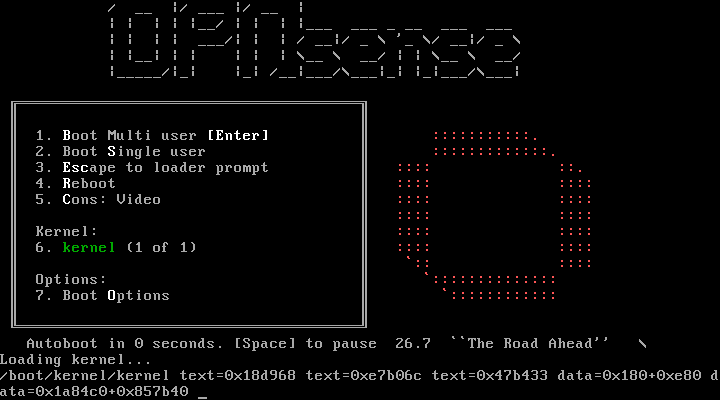

**2. Sistema en modo live, listo para el login `installer`**

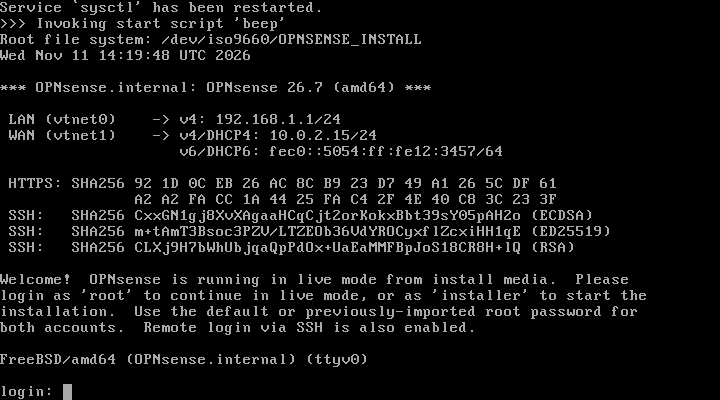

**3. Selección de teclado**

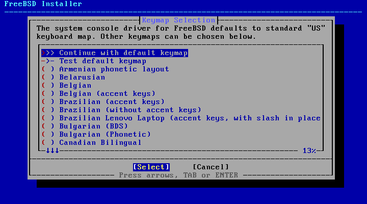

**4. Tipo de instalación: se eligió `Install (UFS)`**

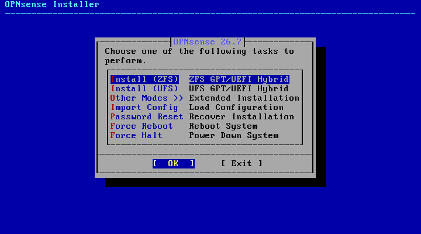

**5. Selección del disco `vtbd0`**

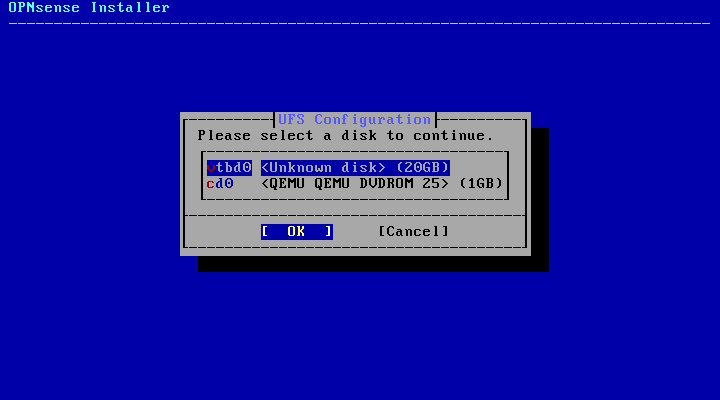

**6. Confirmación de borrado del disco**

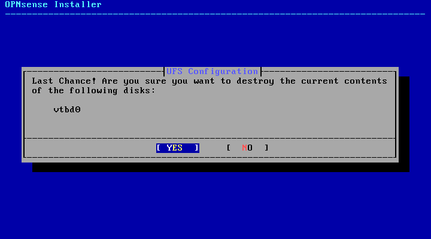

**7. Inicio de la copia**

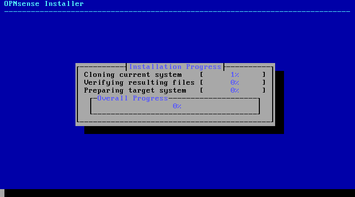

**8. Copia al 80 %**

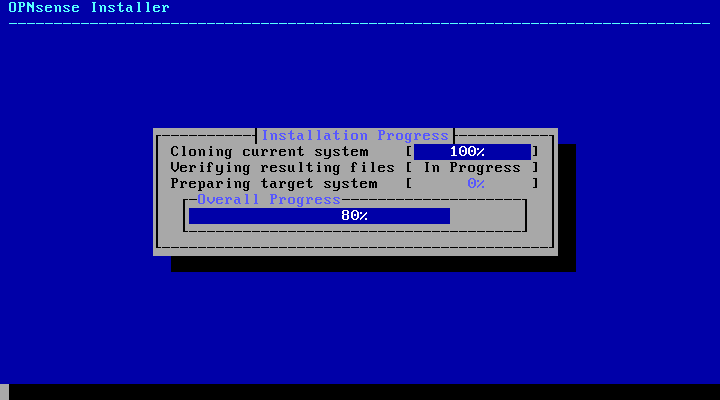

**9. Configuración final**

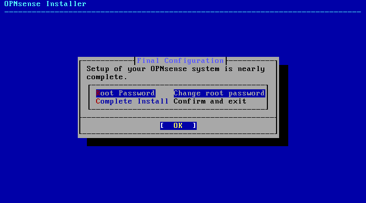

**10. Instalación completa: se eligió `Halt now`**

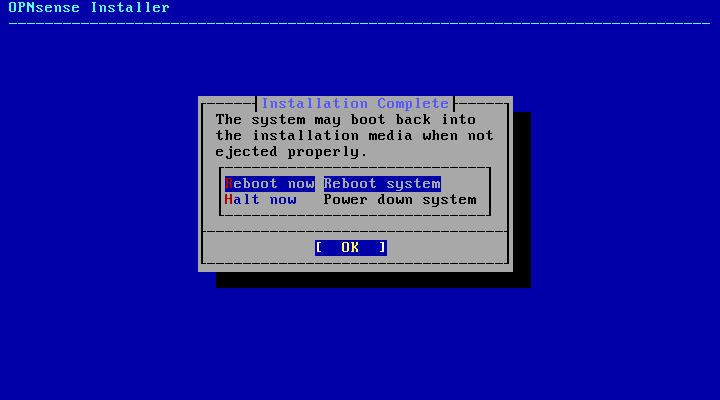

**11. Arranque desde el disco instalado, sin ISO**

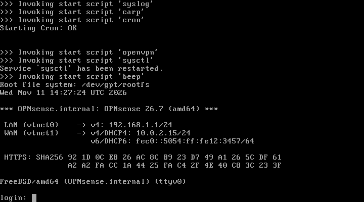

---

## 5. Pendiente

- [x] Crear la plantilla en GNS3 (§2).
- [x] Agregar `FW-ZONA-CENTRO` y `FW-VEHICULO-01` a la topología y cablearlos.
- [x] Cambiar la contraseña de `root` a `test123` en ambos nodos.
- [x] Activar la consola serie para usar telnet en GNS3 (§3).
- La imagen base quedó en solo lectura (`chmod 444`) para protegerla de cambios accidentales.
