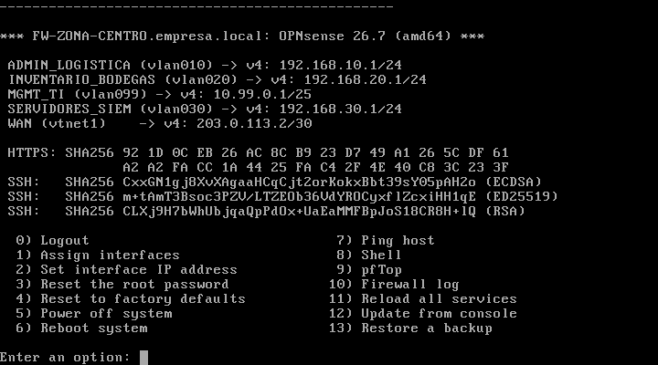
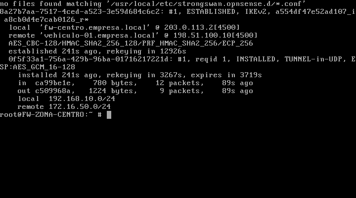
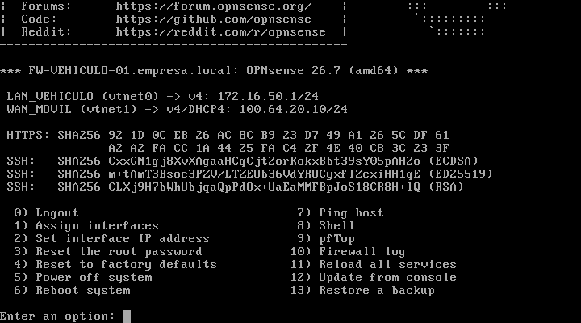
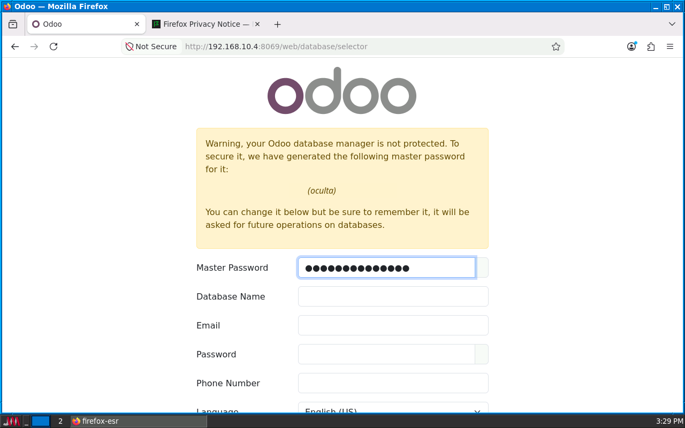

# VPN sede central ↔ vehículo en ruta

Extensión del laboratorio `eval1`. Un conductor en ruta tiene una red propia en el vehículo, que sale a Internet por una red móvil con CGNAT. Esa red se conecta con la VLAN 10 de la sede central, y solo con el host de Odoo de la VLAN 20, mediante un túnel IPsec que cruza la WAN.

**Estado verificado (2026-11-11):** túnel establecido; ping en ambos sentidos entre `TABLET-CONDUCTOR` (172.16.50.10) y `alpine-1` (VLAN 10); Odoo de la sede abierto en Firefox desde `WEBTERM-VEHICULO` (172.16.50.20). Después, `odoo-1` se movió a la VLAN 20 (192.168.20.5) y se agregó al túnel un Child SA solo para ese host (§3.4 y §5).

---

## 1. Topología

```
                                   Internet
                                      │
                               NAT1 (virbr0)
                                      │ Gi0/0 (DHCP 192.168.122.x)
                             ┌────────┴────────┐
                             │     ISP-WAN     │  IOSv: "operador"
                             └──┬───────────┬──┘
           Gi0/1 203.0.113.1/30 │           │ Gi0/2 100.64.20.1/24 (red móvil, DHCP)
                                │           │       CGNAT → 198.51.100.10
          vtnet1 203.0.113.2/30 │           │ vtnet1 100.64.20.10 (DHCP)
                    ┌───────────┴───┐   ┌───┴────────────┐
                    │FW-ZONA-CENTRO │═══│ FW-VEHICULO-01 │   ═══ túnel IPsec IKEv2 (NAT-T, UDP 4500)
                    └───────┬───────┘   └───────┬────────┘
             vtnet0 (trunk) │                   │ vtnet0 172.16.50.1/24
          VLAN 10/20/30/99  │                   │
                    ┌───────┴───────┐   ┌───────┴───────┐
                    │SW-ZONA-CENTRO │   │  SW-VEHICULO  │
                    └───────────────┘   └───┬───────┬───┘
                                            │       │
                          ┌─────────────────┴┐   ┌──┴───────────────┐
                          │ TABLET-CONDUCTOR │   │ WEBTERM-VEHICULO │
                          │   172.16.50.10   │   │   172.16.50.20   │
                          └──────────────────┘   └──────────────────┘
```

`RTR-ZONA-CENTRO` (`CiscoRTT-1`) sigue en el proyecto, apagado y **sin enlaces**. `FW-ZONA-CENTRO` lo reemplaza; su configuración original está en [configs/RTR-ZONA-CENTRO_running-config.txt](../configs/RTR-ZONA-CENTRO_running-config.txt).

### 1.1 Nodos nuevos

| Nodo GNS3 | Plantilla | Función | Consola |
|---|---|---|---|
| `ISP-WAN` | CiscoRTT (IOSv 15.9) | Operador: Internet, red móvil y CGNAT | telnet 5015 |
| `FW-ZONA-CENTRO` | OPNsense-26.7 | Firewall de frontera de la sede | telnet 5017 (serie) |
| `FW-VEHICULO-01` | OPNsense-26.7 | Router del vehículo | telnet 5023 (serie) |
| `TABLET-CONDUCTOR` | alpine (Docker) | Dispositivo del conductor | telnet 5025 |
| `SW-VEHICULO` | Ethernet switch (integrado) | LAN del vehículo, todos los puertos en VLAN 1 | — |
| `WEBTERM-VEHICULO` | `gns3/webterm` (Docker) | Navegador Firefox para probar Odoo por el túnel | VNC 5901 |

### 1.2 Enlaces

| Extremo A | Puerto A | Extremo B | Puerto B |
|---|---|---|---|
| NAT1 | nat0 | ISP-WAN | Gi0/0 |
| ISP-WAN | Gi0/1 | FW-ZONA-CENTRO | vtnet1 |
| FW-ZONA-CENTRO | vtnet0 | CiscoSW-1 | Gi0/0 (trunk) |
| ISP-WAN | Gi0/2 | FW-VEHICULO-01 | vtnet1 |
| FW-VEHICULO-01 | vtnet0 | SW-VEHICULO | Ethernet0 |
| TABLET-CONDUCTOR | eth0 | SW-VEHICULO | Ethernet1 |
| WEBTERM-VEHICULO | eth0 | SW-VEHICULO | Ethernet2 |

### 1.3 Direccionamiento

| Red | Uso |
|---|---|
| 203.0.113.0/30 | Enlace ISP ↔ sede (IP pública fija de la empresa: .2) |
| 100.64.20.0/24 | Red móvil del operador (RFC 6598, CGNAT). El ISP entrega IP por DHCP desde .10 |
| 198.51.100.10 | IP pública compartida del CGNAT: así ve la sede al vehículo |
| 172.16.50.0/24 | LAN del vehículo |
| 192.168.10.0/24 | VLAN 10 de la sede, el destino de la VPN |
| 192.168.20.5/32 | `odoo-1` (VLAN 20), el único host de la VLAN 20 dentro de la VPN |

Los rangos 203.0.113.0/24 y 198.51.100.0/24 son de documentación (RFC 5737). En OPNsense cuentan como *bogons*, así que en las WAN de ambos firewalls están desactivadas las opciones **Block private networks** y **Block bogon networks**.

---

## 2. ISP-WAN

Configuración completa: [configs/ISP-WAN_running-config.txt](../configs/ISP-WAN_running-config.txt).

- Gi0/0 obtiene IP por DHCP desde NAT1 y es la salida a Internet.
- Pool DHCP `RED_MOVIL` para el vehículo (100.64.20.10–254).
- NAT con NVI (`ip nat enable` en las tres interfaces), porque se traduce entre interfaces "internas":

```
ip access-list extended NAT_CGNAT
 permit ip 100.64.20.0 0.0.0.255 203.0.113.0 0.0.0.3
ip nat pool CGNAT_PUBLICA 198.51.100.10 198.51.100.10 prefix-length 24
ip nat source list NAT_CGNAT pool CGNAT_PUBLICA overload
ip nat source list NAT_INTERNET interface GigabitEthernet0/0 overload
```

El tráfico del vehículo hacia la sede sale con origen 198.51.100.10 (CGNAT simulado). El resto del tráfico de ambos clientes sale a Internet real por Gi0/0. El vehículo nunca recibe una IP pública propia, por lo que la sede no puede iniciar el túnel. **Por eso el vehículo es el iniciador y la sede solo responde.**

---

## 3. FW-ZONA-CENTRO

Reproduce lo que hacía `RTR-ZONA-CENTRO` y agrega la VPN.

### 3.1 Interfaces

| Interfaz OPNsense | Dispositivo | IP | Equivale en el router IOS |
|---|---|---|---|
| WAN | `vtnet1` | 203.0.113.2/30, gateway 203.0.113.1 (`WAN_GW`) | Gi0/0 |
| ADMIN_LOGISTICA (`opt1`) | `vlan010` | 192.168.10.1/24 | Gi0/1.10 |
| INVENTARIO_BODEGAS (`opt2`) | `vlan020` | 192.168.20.1/24 | Gi0/1.20 |
| SERVIDORES_SIEM (`opt3`) | `vlan030` | 192.168.30.1/24 | Gi0/1.30 |
| MGMT_TI (`lan`) | `vlan099` | 10.99.0.1/25 | Gi0/1.99 |

Las cuatro VLAN van sobre `vtnet0`, que es el trunk hacia `SW-ZONA-CENTRO` Gi0/0. El switch no se modificó.



### 3.2 Servicios

| Servicio | Configuración |
|---|---|
| DHCP (Dnsmasq) | VLAN 10: .11–.254; VLAN 20: .11–.254; DNS 1.1.1.1 y 8.8.8.8, igual que los pools IOS |
| Syslog remoto | 192.168.30.5 UDP 514 (SIEM Wazuh) |
| SSH | Solo en MGMT_TI (VLAN 99), usuario `root` |
| NAT de salida | Automático. El criterio 4 se cumple con reglas de filtrado (ver §3.3) |

### 3.3 Reglas de firewall (criterios del ejercicio)

Desde el 2026-11-13 (U3, [U3_SEGURIDAD_PERIMETRAL.md](U3_SEGURIDAD_PERIMETRAL.md)) todas las reglas registran en el log, su descripción empieza con el código R-xx del informe de la Unidad 3 y cada interfaz termina con una regla de bloqueo con registro (R-99). pf tiene estado, así que las respuestas no necesitan regla. La regla 4 de [INFRAESTRUCTURA.md §8](linea-base/INFRAESTRUCTURA.md) (las respuestas a la VLAN 99 se descartaban) desaparece.

| # | Interfaz | Origen → Destino | Puertos | Criterio |
|---|---|---|---|---|
| 10 | VLAN 10 | VLAN 10 → `RED_VEHICULO` | todos | VPN. **Deshabilitada** desde el 2026-11-13 (mínimo privilegio, U3) |
| 20 | VLAN 10 | VLAN 10 → `SIEM_WAZUH` | 514, 1514, 1515 TCP/UDP | 2 |
| 25 | VLAN 10 | VLAN 10 → `WMS_ODOO` (192.168.20.5) | `PUERTOS_WMS` (8069 TCP) | Excepción puntual al criterio 1: usuarios hacia Odoo. U3: R-01 |
| 30 | VLAN 10 | VLAN 10 → no `RFC1918` | `PUERTOS_SALIDA_V10`: 53, 123, 443 TCP/UDP (sin 80 desde el 2026-11-13) | 4. U3: R-05 |
| 40 | VLAN 10 | VLAN 10 → no `RFC1918` | ICMP | 4 |
| 50 | VLAN 20 | VLAN 20 → `SIEM_WAZUH` | 514, 1514, 1515 TCP/UDP | 2 |
| 60 | VLAN 30 | VLAN 30 → 192.168.30.1 | 53, 123 TCP/UDP | DNS/NTP al gateway |
| 70 | VLAN 99 | VLAN 99 → VLAN 10/20/30 | 22, 161, 443 TCP/UDP | 3 |
| 80 | VLAN 99 | VLAN 99 → VLAN 10/20/30 | ICMP | 3 |
| 90 | VLAN 99 | VLAN 99 → `SIEM_WAZUH` | 443, 514, 1514, 1515, 5601, 9200, 55000 | 3 |
| 95 | VLAN 10, 20 y 30 | Cada VLAN → `PKI_CA` (10.99.0.10) | 80, 2560 TCP (`PUERTOS_PKI`) | CRL y OCSP de la PKI (2026-11-13, [PKI.md](PKI.md)) |
| 200 | IPsec | `RED_VEHICULO` → VLAN 10 | todos | VPN. **Deshabilitada** desde el 2026-11-13 (mínimo privilegio, U3) |
| 210 | IPsec | `RED_VEHICULO` → `WMS_ODOO` | `PUERTOS_WMS` | VPN: solo Odoo de la VLAN 20, y desde el 2026-11-13 solo en el horario `HORARIO_DESPACHO` (lunes a sábado 07:00–20:00 Chile). U3: R-02 |
| 300 | WAN | cualquiera → IP WAN | UDP 500 | VPN: IKE |
| 310 | WAN | cualquiera → IP WAN | UDP 4500 | VPN: NAT-T |
| 320 | WAN | cualquiera → IP WAN | ESP | VPN |
| 9000 | Todas (VLAN 10, 20, 30, 99, IPsec y WAN) | cualquiera → cualquiera | todos | **Bloquear con registro** (U3: R-99), desde el 2026-11-13 |

- **Criterio 1** (aislamiento entre VLANs): lo cumple el bloqueo por defecto. La antigua regla 25 (`odoo-1` en la VLAN 10 → `postgres-1` 5432) se quitó el 2026-11-11: los dos están ahora en la VLAN 20 y no pasan por el firewall. El número 25 lo usa ahora la regla VLAN 10 → Odoo 8069.
- **Criterio 5** (solo la VLAN 99 entra por SSH): SSH escucha solo en MGMT_TI, y la regla *anti-lockout* de OPNsense solo existe en esa interfaz.
- El anti-spoofing lo cumple que todas las reglas usan como origen la red de su propia interfaz.
- El alias `SIEM_WAZUH` contiene 192.168.30.5, .6 y .7 desde que Wazuh pasó a Docker (2026-11-11, [configs/opnsense/siem-alias.php](../configs/opnsense/siem-alias.php) y [WAZUH_DOCKER.md](WAZUH_DOCKER.md)). Antes solo tenía 192.168.30.5.
- Las reglas 300–320 aceptan cualquier origen porque la IP del vehículo cambia (CGNAT). La autenticación es por identidad y PSK.

### 3.4 IPsec (respondedor)

| Campo | Valor |
|---|---|
| Versión | IKEv2 |
| Dirección local / remota | 203.0.113.2 / cualquiera |
| Autenticación local | PSK, ID `fw-centro.empresa.local` |
| Autenticación remota | PSK, ID `vehiculo-01.empresa.local` |
| Child SA | 192.168.10.0/24 ↔ 172.16.50.0/24, `start_action = none` (solo responde) |
| Child SA | 192.168.20.5/32 ↔ 172.16.50.0/24, `start_action = none`: solo `odoo-1`; el resto de la VLAN 20 queda fuera del túnel |
| DPD | 30 s, acción `clear` |



La sede ve al vehículo como `198.51.100.10[4500]`: la IP del CGNAT, no la real (100.64.20.10). El túnel va como `TUNNEL-in-UDP`, porque strongSwan detectó el NAT y encapsuló ESP en UDP 4500 (NAT-T).

---

## 4. FW-VEHICULO-01

| Elemento | Valor |
|---|---|
| WAN_MOVIL (`vtnet1`) | DHCP del operador (recibió 100.64.20.10) |
| LAN_VEHICULO (`vtnet0`) | 172.16.50.1/24, DHCP .100–.200 |
| Reglas | LAN → cualquiera (la regla por defecto); IPsec: VLAN 10 → LAN |
| IPsec | IKEv2 hacia 203.0.113.2, ID local `vehiculo-01.empresa.local`, ID remoto `fw-centro.empresa.local` |
| Child SA | 172.16.50.0/24 ↔ 192.168.10.0/24, `start_action = trap\|start`, `dpd_action = start`, `close_action = start` |
| Child SA | 172.16.50.0/24 ↔ 192.168.20.5/32 (`odoo-1`), mismas opciones |

Con `trap|start`, el vehículo levanta el túnel al arrancar y lo vuelve a levantar si cae o si aparece tráfico hacia la VLAN 10. Así se recupera solo cuando el operador le cambia la IP.




---

## 5. Pruebas

| Prueba | Resultado |
|---|---|
| `alpine-1` (VLAN 10) obtiene IP por DHCP de `FW-ZONA-CENTRO` | ✅ 192.168.10.230, DNS 1.1.1.1 y 8.8.8.8 |
| `alpine-1` → Internet (`ping 1.1.1.1`, `nslookup`) | ✅ (criterio 4) |
| `TABLET-CONDUCTOR` → `alpine-1` por el túnel | ✅ 0 % de pérdida, ~8 ms |
| `alpine-1` → `TABLET-CONDUCTOR` por el túnel | ✅ 0 % de pérdida |
| `TABLET-CONDUCTOR` → 192.168.20.1 (fuera del túnel) | ✅ bloqueado (100 % de pérdida) |
| ISP-WAN: traducción del IKE del vehículo | ✅ `198.51.100.10:500 ← 100.64.20.10:500 → 203.0.113.2:500` |
| `WEBTERM-VEHICULO` → `odoo-1` (entonces 192.168.10.4) por el túnel | ✅ ping 0 % de pérdida (~4 ms); `http://192.168.10.4:8069` responde 200 y Firefox muestra Odoo |
| **Odoo en la VLAN 20** (2026-11-11): `TABLET-CONDUCTOR` → `http://192.168.20.5:8069/web/login` | ✅ `303 SEE OTHER` (redirige al asistente de base de datos) |
| `TABLET-CONDUCTOR` → 192.168.20.4:5432 (`postgres-1`) | ✅ bloqueado: no hay Child SA para ese host |
| `TABLET-CONDUCTOR` → ping 192.168.20.5 | ✅ bloqueado: la regla 210 solo deja pasar 8069 |
| `alpine-1` (VLAN 10) → 192.168.20.5:8069 | ✅ `303 SEE OTHER` (regla 25) |
| `alpine-1` → ping 192.168.20.5, 192.168.20.5:22, 192.168.20.4:5432 | ✅ bloqueados |
| `odoo-1` → `postgres-1` | ✅ conecta; PostgreSQL ve el cliente 192.168.20.5 |
| **U3, reglas con registro y horario** (2026-11-13, 21:10 Chile): `TABLET-CONDUCTOR` → `http://192.168.20.5:8069` fuera del horario de despacho | ✅ sin respuesta; bloqueo registrado por la regla 9000 (R-99) de IPsec. Con el horario abierto a todo el día (prueba): `303`. Horario restaurado |
| `TABLET-CONDUCTOR` → `alpine-1` (VLAN 10) | ✅ bloqueado desde que se deshabilitó la regla 200 (100 % de pérdida) |
| `alpine-1` → `http://example.com` / `https://example.com` | ✅ 80 bloqueado (antes 200) / 443 `200 OK` |



Odoo todavía no tiene base de datos: abre el asistente de creación (`/web/database/selector`). En la captura se ocultó la contraseña maestra que Odoo genera.

### 5.1 Consola gráfica (WEBTERM-VEHICULO)

- IP fija 172.16.50.20/24, gateway 172.16.50.1, DNS 1.1.1.1 (en `/etc/network/interfaces` del nodo).
- Para abrir la consola: doble clic en el nodo. El cliente GNS3 debe tener un visor VNC configurado (Preferences → General → VNC), por ejemplo `remote-viewer vnc://{host}:{port}`. El valor por defecto (`vncviewer {host}:{port}`) falla en este host porque `vncviewer` no está instalado.
- GNS3 2.2 necesita **TigerVNC** en el host (`tigervnc-standalone-server`, que da `Xtigervnc`). Xvfb + x11vnc no sirven. Sin TigerVNC, el nodo no se puede crear con consola VNC. Si se crea con consola telnet, Firefox no tiene pantalla, el contenedor se cierra y uBridge falla con `Unknown module 'bridge' ... Bad address`.

```
/ # traceroute -n 192.168.10.230        (desde TABLET-CONDUCTOR)
 1  172.16.50.1  0.736 ms
 2  *  *  *                             ← FW-ZONA-CENTRO, dentro del túnel
 3  192.168.10.230  7.259 ms
```

No se probaron con tráfico real: las reglas de las VLAN 20, 30 y 99 (`postgres-1`, el SIEM y los Mint no estaban encendidos) y la recepción de los logs en Wazuh.

---

## 6. Cómo se configuró

Los firewalls se configuraron por la consola serie, con scripts PHP que usan los modelos de OPNsense. Así cada cambio pasa por la misma validación que la interfaz web. Los scripts están en [configs/opnsense/](../configs/opnsense/):

| Script | Qué hace |
|---|---|
| `lib.php` | Funciones comunes: agregar elementos a un modelo, validar y guardar |
| `fw-zona-centro.php` | Sistema, interfaces, VLANs, gateway, DHCP, alias, reglas, syslog e IPsec de la sede |
| `siem-alias.php` | Amplía `SIEM_WAZUH` a los tres nodos de Wazuh en Docker. Después: `configctl filter reload` y `configctl filter refresh_aliases` |
| `fw-vehiculo-01.php` | Lo mismo para el vehículo |
| `ipsec-enable.php` | Activa IPsec (`ipsec.enable` es un campo heredado que el modelo no guarda) |
| `enc0-rule.php`, `add-rule.php` | Reglas que se agregan después: la interfaz IPsec (`enc0`) solo existe con IPsec activo |
| `pki-regla.php` | Regla 95 (VLAN 10/20/30 → `PKI-CA` TCP 80 y 2560) y alias `PKI_CA`, `PUERTOS_PKI`. Después: `configctl filter reload` y `configctl filter refresh_aliases` |
| `odoo-vlan20.php centro\|vehiculo` | Odoo en la VLAN 20: en la sede quita la regla 25 antigua, agrega las reglas 25 (VLAN 10 → 8069) y 210 (vehículo → 8069) y el Child SA de 192.168.20.5; en el vehículo agrega el Child SA. Después: `configctl filter reload` (sede) y `pluginctl -c ipsec` (ambos) |
| `u3-reglas.php` | U3 (2026-11-13): registro en todas las reglas de la sede, códigos R-xx, reglas 10 y 200 deshabilitadas, regla 30 sin HTTP 80, horario `HORARIO_DESPACHO` en la regla 210, alias `WMS_ODOO`, `PUERTOS_WMS` y `PUERTOS_SALIDA_V10`, y regla 9000 de bloqueo con registro en cada interfaz. Después: `configctl filter reload` y `configctl filter refresh_aliases`. Detalle en [U3_SEGURIDAD_PERIMETRAL.md](U3_SEGURIDAD_PERIMETRAL.md) |
| `u3-horario-prueba.php` | Cambia las horas de `HORARIO_DESPACHO` para probar la regla 210 fuera de horario (y para restaurarlas) |

Orden en cada firewall: `fw-*.php` → `ipsec-enable.php` → `reboot` → `pluginctl -c ipsec` → `enc0-rule.php` / `add-rule.php` → `configctl filter reload`.

Notas de lo que se aprendió:
- La consola serie se activó con `<secondaryconsole>serial</secondaryconsole>` en `config.xml` y `/boot/loader.conf.local` (`boot_multicons`, `console="vidconsole,comconsole"`). La plantilla de GNS3 usa consola telnet; la pantalla VGA sigue disponible para capturas desde el monitor de QEMU.
- OPNsense 26.7 no tiene ISC DHCP: el DHCP lo da Dnsmasq.
- OPNsense no agrega las reglas automáticas de IKE/ESP en la WAN cuando la dirección remota es "cualquiera". Hay que crearlas a mano (reglas 300–320).
- Los dos firewalls tienen **las mismas claves SSH y el mismo certificado HTTPS**: se generaron al instalar la imagen base y las copias enlazadas los heredan (se ve en las capturas). En un laboratorio da igual; en producción habría que regenerarlos en cada equipo.

---

## 7. Credenciales

| Equipo | Usuario | Contraseña |
|---|---|---|
| FW-ZONA-CENTRO (consola, SSH desde la VLAN 99, web `https://10.99.0.1`) | `root` | `test123` |
| FW-VEHICULO-01 (consola, SSH desde su LAN, web `https://172.16.50.1`) | `root` | `test123` |
| PSK del túnel | — | `test123` |
| ISP-WAN | sin contraseña (consola directa) | — |
