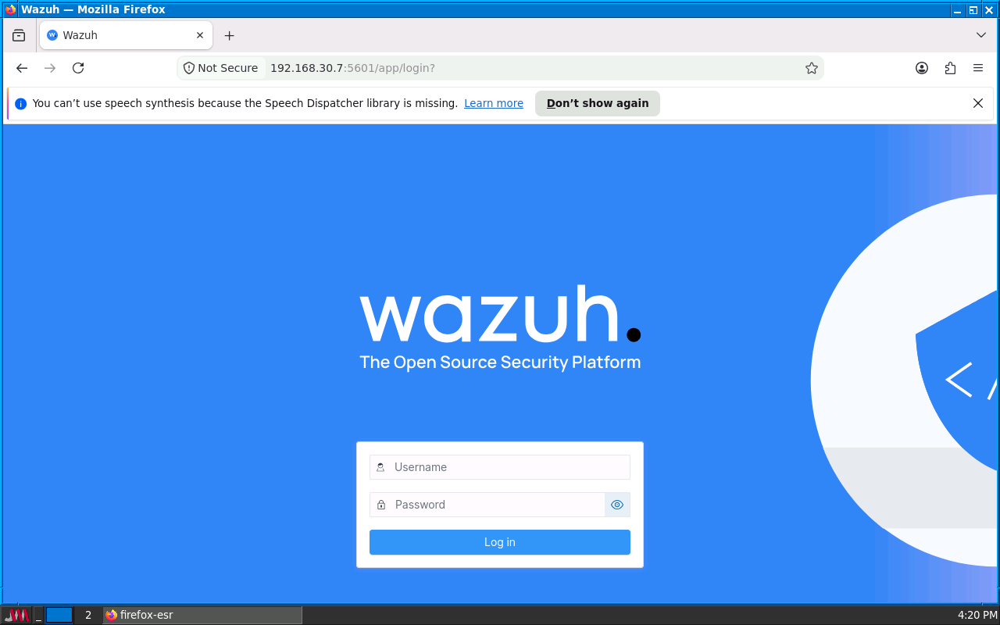

# Wazuh en Docker — `eval1`

El SIEM pasó de una VM QEMU (Ubuntu 22.04 con Wazuh *all-in-one*, 4 vCPU y 8 GB) a los tres contenedores oficiales de **Wazuh 4.14.10**, cada uno como nodo Docker de GNS3 en la VLAN 30. Migración hecha el 2026-11-11.

La VM `SIEM` sigue en el proyecto, apagada y sin enlaces, igual que `RTR-ZONA-CENTRO`. No se migraron datos: estaba apagada y no había agentes registrados.

---

## 1. Nodos

| Nodo GNS3 | Imagen | IP | Puerto del switch | Consola | Servicios |
|---|---|---|---|---|---|
| `WAZUH-MANAGER` | `wazuh-manager-gns3:4.14.10` | 192.168.30.5 | Gi2/1 | telnet 5031 | Agentes 1514/1515 TCP, syslog 514/UDP, API 55000 |
| `WAZUH-INDEXER` | `wazuh-indexer-gns3:4.14.10` | 192.168.30.6 | Gi2/2 | telnet 5034 | OpenSearch 9200 |
| `WAZUH-DASHBOARD` | `wazuh-dashboard-gns3:4.14.10` | 192.168.30.7 | Gi2/3 | telnet 5036 | Dashboard HTTPS 5601 |

- Gateway 192.168.30.1 (`FW-ZONA-CENTRO`). IP fija en `/etc/network/interfaces` de cada nodo.
- El manager conserva la IP de la VM. Por eso el syslog del firewall, el destino de los agentes y las reglas no cambian.
- `extra_hosts` resuelve `wazuh.manager`, `wazuh.indexer` y `wazuh.dashboard`. Aun así, toda la configuración usa IPs (§3).
- Orden de arranque recomendado: indexer, manager, dashboard. Si el dashboard arranca antes que el indexer, reintenta solo.

```
VLAN 30 (192.168.30.0/24)
  Gi2/1  WAZUH-MANAGER   .5  ──filebeat 9200──►  WAZUH-INDEXER .6  (Gi2/2)
  Gi2/3  WAZUH-DASHBOARD .7  ──9200──► indexer, ──55000──► manager
```

El tráfico entre los tres va por capa 2 dentro de la VLAN 30 y no pasa por el firewall.

---

## 2. Imágenes

Los archivos están en [docker/wazuh-gns3/](../docker/wazuh-gns3/). Se parte de las imágenes oficiales y de la configuración *single-node* de `wazuh-docker` v4.14.10 (copia en `upstream/`).

GNS3 no admite montar archivos del host. Por eso los certificados y la configuración van **dentro** de cada imagen.

| Imagen | Cambios sobre la oficial |
|---|---|
| `wazuh-indexer-gns3` | Shell `/bin/bash` para `wazuh-indexer`; certificados; `opensearch.yml`; `internal_users.yml` con el hash de la contraseña de `admin` (§5); heap de 1 GB |
| `wazuh-manager-gns3` | Certificados de Filebeat; `ossec.conf` con un `<remote>` syslog UDP 514 (permitido desde 192.168.0.0/16, 10.99.0.0/24 y 172.16.50.0/24); variables de entorno |
| `wazuh-dashboard-gns3` | Shell `/bin/bash` para `wazuh-dashboard`; certificados; `opensearch_dashboards.yml` y `wazuh.yml` apuntando a las IPs |

Reconstruir:

```bash
cd docker/wazuh-gns3 && ./build.sh
```

Certificados: `certs.yml` con las tres IPs, generados con `wazuh/wazuh-certs-generator:0.0.5`:

```bash
docker run --rm -e CERT_TOOL_VERSION=4.14 -v "$PWD/certs:/certificates/" \
  -v "$PWD/certs.yml:/config/certs.yml" wazuh/wazuh-certs-generator:0.0.5
```

---

## 3. Problemas encontrados

1. **Usuarios con `nologin`.** GNS3 arranca los contenedores con `su <usuario de la imagen>`. `wazuh-indexer` y `wazuh-dashboard` tienen `/sbin/nologin`, igual que `odoo` (INFRAESTRUCTURA.md §8, hallazgo 3). Solución: `usermod -s /bin/bash`.
2. **El manager necesita PID 1.** Usa s6-overlay (`/init`). El `su` de GNS3 es el de busybox y hace `exec`, así que `/init` queda como PID 1. Verificado: PID 1 es `s6-svscan`.
3. **Los certificados solo llevan IP en el SAN.** El generador no añade el nombre DNS. Filebeat verifica en modo `full`, así que el manager usa `https://192.168.30.6:9200`. El dashboard y `wazuh.yml` también usan IPs.
4. **`COPY --chmod=400` también cambia el directorio que crea.** El directorio `certs/` del dashboard quedaba en `dr--------` y el dashboard no arrancaba (`EACCES` al leer la clave). Solución: crear el directorio antes con `install -d -m 750`.
5. **GNS3 no cambia la imagen de un contenedor existente.** Parar y arrancar un nodo reutiliza el contenedor. Para usar una imagen reconstruida con el mismo tag hay que forzar la recreación. Cambiar `image` por la API no sirve: no está entre las propiedades que la disparan. Sí la disparan `extra_hosts`, `environment`, `adapters`, etc. Basta con modificar `extra_hosts` y volver a dejarlo como estaba. Cerrar y abrir el proyecto también recrea todos los contenedores.

---

## 4. Persistencia

GNS3 borra los contenedores al cerrar el proyecto. Los datos se guardan en `extra_volumes`, dentro de `project-files/docker/<id del nodo>/`:

| Nodo | Volúmenes |
|---|---|
| `WAZUH-INDEXER` | `/var/lib/wazuh-indexer` |
| `WAZUH-MANAGER` | `/var/ossec/{api/configuration,etc,logs,queue,var/multigroups,integrations,active-response/bin,agentless,wodles}`, `/etc/filebeat`, `/var/lib/filebeat` |
| `WAZUH-DASHBOARD` | `/usr/share/wazuh-dashboard/data/wazuh/config` |

`ossec.conf` se vuelve a copiar desde la imagen (`/wazuh-config-mount`) en cada arranque. Para cambiarlo de forma permanente, edita `docker/wazuh-gns3/manager/ossec.conf` y reconstruye.

---

## 5. Credenciales

| Servicio | Usuario | Contraseña |
|---|---|---|
| Dashboard e indexer | `admin` | `g0XCwEOvqhmcu7j4zC*RF6UMQfed9wBD` (la misma que tenía la VM) |
| API de Wazuh (la usa el dashboard) | `wazuh-wui` | `MyS3cr37P450r.*-` (valor por defecto de `wazuh-docker`) |
| Dashboard → indexer | `kibanaserver` | `kibanaserver` (valor por defecto) |

Las contraseñas están en las variables `ENV` de los Dockerfile y en los certificados de `docker/wazuh-gns3/certs/`. Es un laboratorio de estudio.

---

## 6. Firewall

En `FW-ZONA-CENTRO`, el alias `SIEM_WAZUH` pasó de `192.168.30.5` a `192.168.30.5`, `.6` y `.7` ([configs/opnsense/siem-alias.php](../configs/opnsense/siem-alias.php)). Las reglas no cambiaron (VPN_VEHICULO.md §3.3):

- VLAN 10 y 20 → `SIEM_WAZUH`: 514, 1514 y 1515.
- VLAN 99 → `SIEM_WAZUH`: 443, 514, 1514, 1515, 5601, 9200 y 55000. Desde la VLAN 99 el dashboard está en `https://192.168.30.7:5601`.

---

## 7. Verificación (2026-11-11)

| Prueba | Resultado |
|---|---|
| Salud del indexer con `admin` y la contraseña de §5 | `green`, 1 nodo |
| `filebeat test output` en el manager | TLS 1.2 OK, conecta con 192.168.30.6:9200 |
| Login en la API (`wazuh-wui`) | Devuelve un token JWT |
| Dashboard: `/app/login` y `POST /auth/login` con `admin` | HTTP 200 y 200 |
| Dashboard → API del manager | Responde (HTTP 401 sin token, como debe) |
| Alertas en el indexer | Existe el índice `wazuh-alerts-4.x-2026.11.11` |
| Syslog desde el firewall: `logger -p auth.warning -t sshd 'Failed password for invalid user eval1test ...'` en `FW-ZONA-CENTRO` | Alerta 5710, `location: 192.168.30.1`, indexada |
| Persistencia: recrear el contenedor del indexer (cambia el ID) | El documento de la alerta de prueba sigue (`count: 1`) |
| `pfctl -t SIEM_WAZUH -T show` | .5, .6 y .7 |
| Acceso desde la VLAN 99: `WEBTERM-ADMIN` (10.99.0.20, Gi3/3) → `https://192.168.30.7:5601` | `curl` devuelve 302 y 200 en `/app/login`; Firefox muestra el login tras aceptar el certificado autofirmado |



Sin probar: el login en el dashboard desde Firefox (se probó con `POST /auth/login`) y el registro de un agente real.

### 7.1 Consola gráfica (WEBTERM-ADMIN)

Nodo `gns3/webterm` en la VLAN 99, solo para administrar: Firefox por VNC, sin escritorio completo. Gasta mucho menos que SoporteTI o Mint-1.

```bash
setsid remote-viewer vnc://localhost:5902 &
```

- IP fija 10.99.0.20/25, gateway 10.99.0.1, en el archivo `etc/network/interfaces` del nodo (`project-files/docker/`).
- La primera vez Firefox avisa del certificado: *Advanced* → *Proceed to 192.168.30.7:5601*.
- `10.99.0.1` no responde al ping desde la VLAN 99, aunque el ARP resuelve. No afecta al acceso al dashboard.
